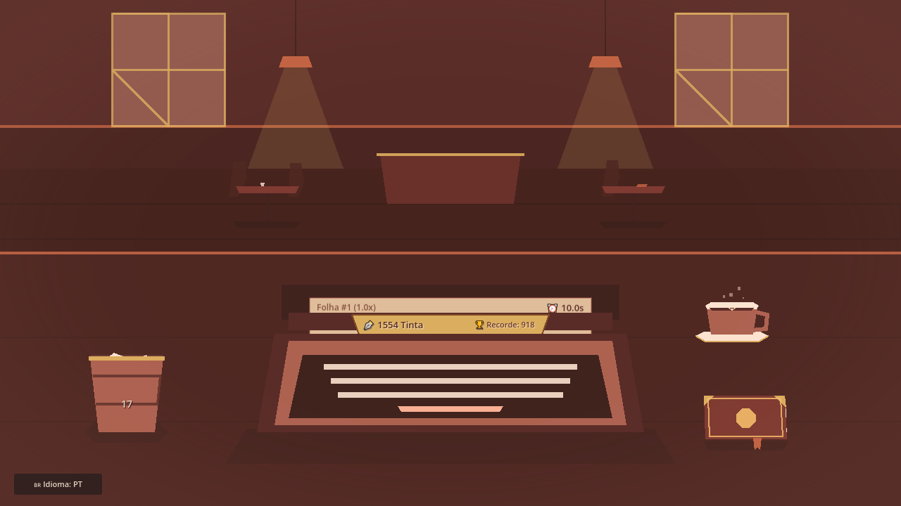
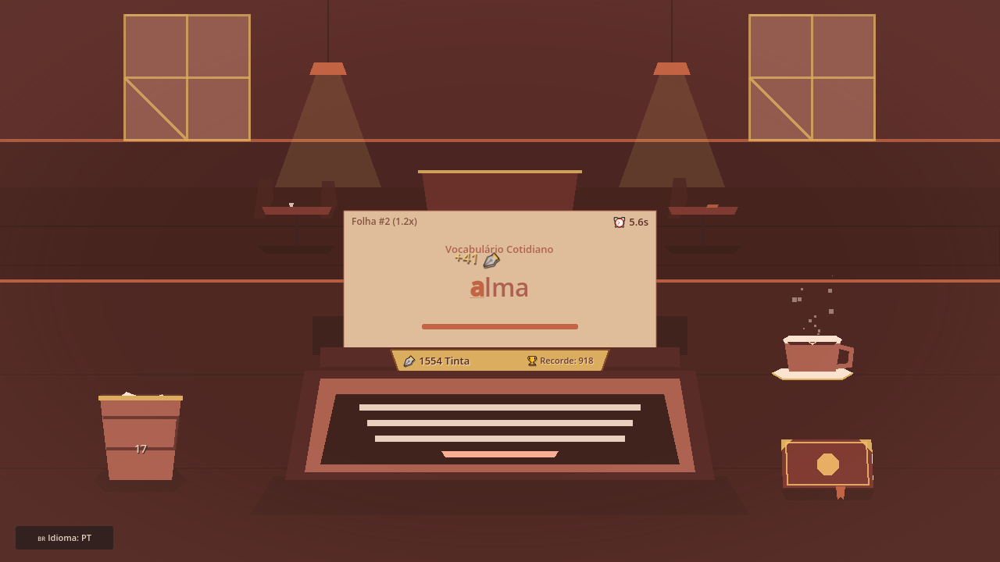
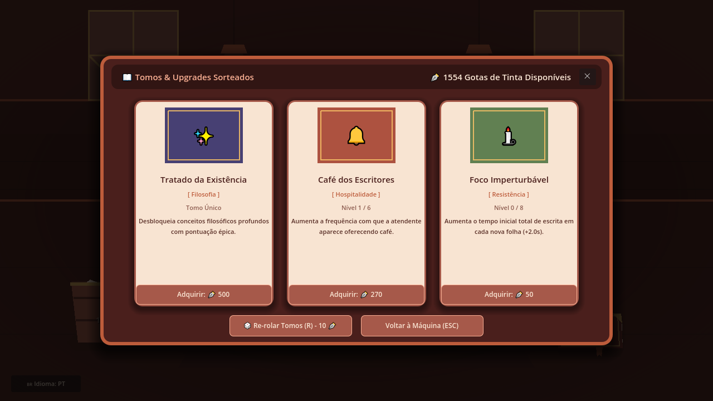

# TypeClicker

A cozy café typing game made in **Godot 4 / GDScript**. You sit at a typewriter, type the words that appear on the sheet, and turn every finished word into ink. Ink buys upgrades from a book of cards, and each sheet you complete makes the next one worth more, until you run out of time and the paper ends up crumpled in the trash.



| Sheet inserted | Typing words | Upgrade book |
| --- | --- | --- |
|  |  |  |

## How it plays

- **Two timers.** A short *thinking timer* runs between keystrokes, and a *writing timer* counts down for the whole sheet. Every completed word adds time back. If either one runs out, the paper is crumpled and the run ends.
- **Score.** Each word's ink is `base points × long-word bonus × letter multiplier × coffee multiplier × sheet multiplier`. The sheet multiplier grows with every sheet finished in the same run.
- **Special sheets.** Some sheets roll as *golden* (3×) or *coffee-stained* (2×).
- **Upgrade book.** After each sheet, a draft of upgrade cards is rolled (with paid rerolls). Upgrades add thinking or writing time, raise multipliers, unlock new word categories (literature, engineering, poetry, gastronomy, philosophy) and make special sheets more likely.
- **Waitress event.** Like the Golden Cookie in Cookie Clicker, a waitress shows up now and then. Click her before she leaves and you get a timed coffee buff.
- **Bilingual.** Words, cards and UI are in Portuguese and English.
- **Save system.** Progress, career stats (words typed, sheets completed, papers crumpled, best run) and settings are saved to `user://typeclicker_save.json`.

## Technical highlights

- **Autoload singletons** keep game state apart from the scenes: `GameManager` (economy, upgrades, run flow, save/load), `SoundManager` (SFX with volume and mute) and `WordDatabase` (word banks by category and language).
- **Signal-driven flow** between systems (`sheet_started`, `sheet_completed`, `paper_crumpled`, `upgrade_purchased`, `coffee_buff_started`…), so the UI reacts to the game state instead of polling it.
- **Data-driven upgrades.** Each upgrade has a level cap, base cost, cost scale and value per level. The card catalog adds localized titles, descriptions and cover colors.
- **Game feel.** A camera shake that builds up and fades out with a quadratic falloff, a short freeze on impact (hitstop), floating score text, a carriage-return lever sound per line, and crumpled paper balls thrown into a trash bin.
- **Custom shaders.** Parchment paper, a gold shine on golden sheets, coffee steam and a warm vignette light.

## Project structure

```
autoload/   GameManager.gd, SoundManager.gd, WordDatabase.gd
scenes/     Main, Typewriter, DeskBook, UpgradeBookModal, UpgradeCardItem,
            WaitressEvent, CoffeeCup, PaperBall, TrashBin, PauseModal, ScoreSummary…
scripts/    one script per scene, plus ShakyCamera2D.gd
shaders/    parchment_paper, gold_shine, coffee_steam, vignette_light
assets/     sound effects
```

## Running it

1. Install [Godot 4](https://godotengine.org/download) (the project is set up for the version in `project.godot`).
2. Open the folder in Godot and press **F5**. The main scene is `scenes/Main.tscn`.

## Status

Work in progress, built as a personal project. Planned next: a visual-novel layer with illustrated chapters and pages working as prestige resets.

---

Made by **Felipe Ortiz**: [LinkedIn](https://www.linkedin.com/in/felipe-ortiz-b692b5274) · [Portfolio](https://portfolio-felipe-ortiz.vercel.app/) · [GitHub](https://github.com/salleF)
